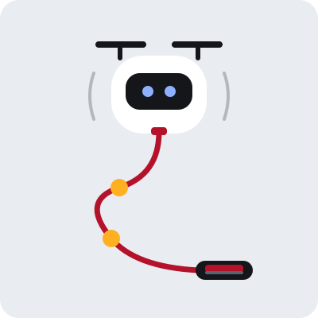
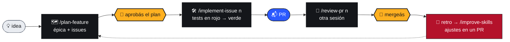

<!-- lang:start -->
<p align="right"><a href="README.md">🇬🇧 English</a> · <b>🇦🇷 Español</b></p>
<!-- lang:end -->

<!-- brand:start -->
<p align="center"></p>
<h3 align="center">Los agentes vuelan. Vos tenés la rienda.</h3>
<p align="center">
  <a href="#empezar"></a>
  <a href="#el-flujo"></a>
  <a href="#skills"></a>
  <a href=".github/brand/README.es.md"></a>
</p>
<!-- brand:end -->

# barrilete-kit

<p>
  
  
  
  
  
  
  
  <a href="LICENSE"></a>
</p>

Plantilla de repo para trabajar con agentes de código **sin perder el control**: reglas claras, documentación que se testea y un flujo de issue a PR donde **las personas aprueban el plan y mergean**.

<table>
  <tr>
    <td width="50%" valign="top">
      <h3>🧭 Reglas para agentes</h3>
      <code>AGENTS.md</code> dice qué puede hacer un agente solo, qué tiene que consultar y qué nunca.
    </td>
    <td width="50%" valign="top">
      <h3>🧰 Skills para todo el ciclo</h3>
      Planificar, abrir issues, implementar con TDD, revisar PRs, debuggear y migrar la base.
    </td>
  </tr>
  <tr>
    <td width="50%" valign="top">
      <h3>✅ Docs como infraestructura</h3>
      CI valida links, rutas y ADRs, y avisa qué docs revisar según lo que cambió.
    </td>
    <td width="50%" valign="top">
      <h3>🔁 Mejora con el uso</h3>
      Cada corrida deja una retro, y los ajustes a las skills llegan siempre en un PR.
    </td>
  </tr>
</table>

<a name="empezar"></a>

## 🚀 Empezar

<!-- template:start -->
> [!NOTE]
> ¿La probás por primera vez para contar cómo te fue? Seguí la [guía de prueba](docs/try-the-template.es.md): pasos, qué anotar y el formulario para reportarlo.
<!-- template:end -->

> [!TIP]
> Necesitás `gh` autenticado (`gh auth status`), `jq` y `python3`. Ver [Requisitos](#requisitos).

1. En GitHub: **Use this template → Create a new repository**, y cloná el repo nuevo.
2. Inicializalo:

   ```bash
   ./scripts/init-template.sh "Nombre del proyecto" main
   ```

   Pone el nombre, la rama base, la regla de ramas y la fecha en todos los archivos, escribe `.agent-kit.json` (commitealo) y se borra solo. Para elegir otra rama base o el modo chico, ver [Modos](#modos).
3. Completá los `TODO:` (`grep -rn "TODO:" .`). Lo mínimo:
   - `AGENTS.md`: qué es, stack, comandos y convenciones de código.
   - `docs/agents-map.json`: las rutas reales de schema, auth, pagos y API pública, y los comandos de `verify`.
   - `.github/labels.yml` y `.github/labeler.yml`: los labels `area:` y las rutas de tu repo.
   - `docs/github-naming-convention.md` §2: los scopes de commit.
4. Cargá al equipo: `/add-member @usuario` por cada integrante, con las áreas que cubre. Desde ahí, cada issue que creen los agentes nace asignado (ver [Equipo y asignación](#equipo)).
5. Creá los labels: **Actions → Labels → Run workflow**.
6. ¿Usás Codex? Enlazá las skills: `mkdir -p .agents && ln -s ../.claude/skills .agents/skills`. Copilot y Cursor las leen de `.claude/skills` sin hacer nada. Ver [Herramientas](#herramientas).

> [!IMPORTANT]
> El check de docs falla a propósito mientras queden rutas `TODO/` en `docs/agents-map.json`: con rutas de ejemplo, un agente nunca detectaría que tocó algo sensible. Las rutas con `?` adelante son alternativas de stack opcionales; las propias van sin `?`, así el check falla si dejan de existir.

### 📥 Sumar a un proyecto existente

¿Ya tenés un repo? El instalador suma el kit sin pisar tus archivos. Corrilo desde la raíz del proyecto, con el working tree limpio:

```bash
curl -fsSL https://raw.githubusercontent.com/lautioliver/barrilete-kit/main/scripts/install.py | python3 - "Proyecto" main [--lang es] [--small] [--draft]
```

O cloná la plantilla y correlo desde el clon, para leerlo antes de correrlo:

```bash
python3 <clon de la plantilla>/scripts/install.py "Proyecto" main
```

`main` es la rama base (o `develop`), y `releases` funciona igual que en el init. `--draft` imprime el plan y no escribe nada. `--template <url o ruta>` y `--version vX.Y.Z` eligen de dónde sale el kit. Lo que va después de `--` se pasa tal cual a `init-template.sh` (por ejemplo `-- --lang es`).

Qué toca:

| Archivo | Qué hace el instalador |
|---|---|
| README, LICENSE | No los toca |
| `.gitignore` | Agrega lo que falta en un bloque `# barrilete` |
| `CLAUDE.md` | Si no importa `@AGENTS.md`, agrega la línea |
| `.claude/settings.json` | Fusión JSON: agrega el hook de barandas a tus hooks. Si el archivo no es JSON válido, no tiene objeto `hooks` o es un enlace simbólico, la versión del kit va a `.agent-kit/pending/` en su lugar |
| Workflow con el mismo nombre | El del kit se instala como `barrilete-<nombre>.yml` |
| `.github/labels.yml` | Los labels del kit más los que el repo tenía al instalar (`gh label list`), así el primer sync no borra ninguno de ellos |
| Cualquier otro archivo que ya tengas (por ejemplo `AGENTS.md`, `docs/README.md`, el template de PR) | Deja el tuyo; la versión del kit va a `.agent-kit/pending/` |

Revisalo antes de commitear nada. El instalador no commitea: mirá `git status` y el diff. Después:

1. Integrá lo que valga la pena de `.agent-kit/pending/` en tus archivos y borrá esa carpeta: `update.py` no corre mientras tenga archivos. Si está `.agent-kit/pending/.github/labels.yml`, fusioná sus labels con tu `.github/labels.yml` antes del primer sync.
2. Si el proyecto ya tenía `.github/labels.yml`, el workflow de Labels (`.github/workflows/labels.yml`) queda en `.agent-kit/pending/` y retenido: `update.py` y `grow.py` no lo traen. Cuando tu `labels.yml` tenga los labels del repo, instalalo vos copiando `.agent-kit/pending/.github/workflows/labels.yml` a `.github/workflows/labels.yml`. La próxima corrida de `update.py` lo saca de `withheld` en `.agent-kit.json`. Hasta entonces no hay sync de labels, así que no borres la carpeta antes de hacerlo.
3. Si `.claude/settings.json` está en `.agent-kit/pending/`, el hook de barandas no está activo hasta que lo integres. Si no, ya queda activo.
4. Justo antes de mergear el PR, corré el comando de labels que imprime el instalador, y commiteá el resultado: el PR puede tardar días, y el primer sync borra los labels creados mientras tanto que no estén en el archivo.

```bash
gh label list --limit 1000 --json name,color,description | python3 scripts/agents/labels.py .github/labels.yml > /tmp/labels.yml && mv /tmp/labels.yml .github/labels.yml
```

Para que un agente haga la integración en el mismo PR, pedile algo así:

> Integrá lo que valga la pena de `.agent-kit/pending/` en mis archivos (AGENTS.md, docs, template de PR), dejá activo el hook de barandas en `.claude/settings.json`, borrá la carpeta, y hacelo en este PR.

<a name="el-flujo"></a>

## 🪁 El flujo



Los agentes hacen el trabajo. Los dos nudos de la correa, **aprobar el plan** y **mergear** 🟡, quedan siempre en manos de personas.

**Barandas.** No depende solo de lo que pide `AGENTS.md`: un hook de Claude Code (`.claude/settings.json` → `scripts/agents/guardrails.py`) frena antes de correrlos el merge y la aprobación de PRs, el push a `main` o `develop`, los tags, las releases, los cambios a la protección de ramas y `--no-verify`, también dentro de comandos compuestos. El mismo script se registra para Codex, Copilot y Cursor (ver [Herramientas](#herramientas)). Si pediste uno de esos pasos, lo corrés vos en el chat: `! gh pr merge 12`. Abrí Claude Code en la raíz del repo: desde un subdirectorio no carga `.claude/settings.json` y el hook no corre. Son barandas, no una cerradura: frenan el error común, pero un agente con tu token puede llegar por otro camino (un script propio, otra herramienta). La cerradura es GitHub: una regla en la rama base que exija una aprobación. Si trabajás solo, esa regla también te frena a vos (GitHub no deja aprobar un PR propio), así que es opcional.

Durante `/implement-issue` se usan, según haga falta, `debug`, `db-migration` y `update-docs`. Si el PR toca rutas sensibles, la revisión suma `/security-review`.

<!-- brand:start -->
<table align="center">
  <tr>
    <td align="center"><br><b>planificando</b><br><sub><code>/plan-feature</code></sub></td>
    <td align="center"><br><b>trabajando</b><br><sub><code>/implement-issue</code></sub></td>
    <td align="center"><br><b>bloqueado</b><br><sub><code>status:blocked</code></sub></td>
    <td align="center"><br><b>PR listo</b><br><sub>esperando tu merge</sub></td>
  </tr>
</table>
<!-- brand:end -->

### 💬 Pedíselo en el chat

| Decís | Pasa |
|---|---|
| 📝 *abrí un issue: el QR no valida sin conexión, es urgente* | `create-issue` arma título y labels según la convención, busca duplicados, te muestra el borrador y lo crea cuando confirmás. |
| 🔗 *la migración de pagos depende de que se cierre el issue 25* | Registra el bloqueo nativo de GitHub ("Blocked by") y pone `status:blocked`. El workflow `unblock.yml` lo saca cuando se cierran los bloqueantes. |
| 🗺️ *planificá la migración de cuentas* | `plan-feature` investiga el código y arma una épica con sub-issues y bloqueos, en el orden en que se pueden hacer. |
| 🔎 *pasá esta auditoría a issues* | Un issue por hallazgo, con el link al documento. |
| 📊 *¿qué puedo hacer ahora?* | `project-status` lista lo que está libre por prioridad, lo bloqueado con su motivo y el avance de cada épica. |
| 👥 *sumá a @ana al equipo, cubre pagos* | `/add-member` valida el usuario y las áreas y lo agrega a `.github/team.json`. Desde ahí, los issues de esa área nacen asignados a quien tenga menos carga. |

<a name="skills"></a>

## 🧰 Skills

Viven en `.claude/skills/`.

| | Skill | Para qué |
|---|---|---|
| 🗺️ | `/plan-feature` | Investiga código, arquitectura y ADRs, arma un plan técnico y lo convierte en épica + issues. No escribe código. |
| 📝 | `create-issue` | Issues sueltos, auditoría → issues, bloqueos entre issues existentes. |
| 🛠️ | `/implement-issue <n>` | Del issue al PR con TDD: tests en rojo desde los criterios de aceptación (`red.sh` comprueba que fallen por una aserción), código hasta verde, autorevisión, docs y PR. No mergea. |
| 🐛 | `debug` | Síntoma → evidencia → causa raíz → arreglo → test de regresión. |
| 🗄️ | `db-migration` | Plan con compatibilidad, backfill y rollback antes de tocar el schema. |
| 📚 | `update-docs` | Qué docs quedaron viejos por un cambio (según el mapa) y corregirlos en el mismo PR. |
| 👀 | `/review-pr <n>` | Revisión con foco en lo propio del proyecto: reglas de negocio, ADRs, autonomía, docs, tests y rutas sensibles. No aprueba. |
| 📊 | `/project-status` | Resumen generado en el momento (versión, trabajo, épicas, PRs, deuda, decisiones, migraciones) y "¿qué puedo hacer ahora?". |
| 🎛️ | `/orchestrate` | Reparte hasta 3 issues disponibles entre subagentes en paralelo (Haiku o Sonnet según `routing.py`, Opus revisa), cada uno en su worktree, y junta PRs, consultas y escalados en un solo mensaje. No mergea ni publica sin confirmación. |
| 🔁 | `/improve-skills` | Junta las retros y las señales objetivas (fallas de CI en ramas de agentes, reverts) y propone ajustes a las skills en un PR. Nunca afloja controles. |
| 🌿 | `git-workflow` | Ramas, commits y PRs. |
| 👥 | `/add-member`, `/remove-member` | Agregar, editar, pausar o quitar integrantes del equipo que recibe los issues. |

### 🤖 Subagentes por modelo

En `.claude/agents/`, cada rol con su modelo:

| | Subagente | Modelo | Para qué |
|---|---|---|---|
| 🛠️ | `implementer` | Sonnet | `implement-issue` en el worktree que le pasan: lógica de negocio, bugs, features y lo que escala el liviano. |
| 🪶 | `implementer-light` | Haiku | Issues chicos sin rutas sensibles ni lógica de negocio. Si se encuentra con algo de eso, frena y escala. |
| 👀 | `reviewer` | Opus | `review-pr` desde otro contexto, en un worktree propio. No publica: devuelve los hallazgos. |

Los lanza `/orchestrate` desde la sesión principal. Comparten las reglas y el formato de salida de `docs/agents/subagent-contract.md`, y cada uno trabaja en su propio worktree (`prepare.sh <n> --worktree`). `check-docs.py` valida que cada uno tenga modelo, herramientas y el contrato.

### 🌱 Cómo aprenden

> [!NOTE]
> Las skills mejoran con el uso, pero **no se reescriben solas**.

1. Cada `implement-issue` y `review-pr` deja una retro en la rama `agents/retros`. Es solo git: no ensucia los PRs ni depende de GitHub.
2. `/improve-skills` busca patrones (al menos dos casos, o uno grave) y prefiere convertirlos en scripts o checks antes que en más texto. Siempre propone en un PR, y se puede programar para que corra una vez por semana.
3. Lo que sirve pero no alcanza para cambiar una skill va a `docs/agents/lessons.md`, que `implement-issue` lee antes de empezar. Los agentes aprenden de lo consolidado y revisado, nunca de retros crudas.

Las skills tienen un máximo de 120 líneas, que controla `check-docs.py`. Dos checks del workflow de labels salieron de este circuito en un repo real: un PR con `business-logic` tiene que tocar `docs/decisions/` (o decir `ADR sin cambios: <motivo>`; `ADR unchanged: <motivo>` también vale), y un PR que llega sin `type:` lo copia del issue que cierra.

<a name="equipo"></a>

### 👥 Equipo y asignación

`.github/team.json` lista a los integrantes (usuario de GitHub, nombre, áreas `area:` que cubren, activo o pausado). Lo leen solo los scripts que crean issues: `create-issue` y `planner.py` (épicas). Cada issue nuevo se asigna así:

1. Entre los activos, los que cubren alguna `area:` del issue.
2. Si nadie la cubre (o el issue no tiene área), todos los activos.
3. Gana el de menos issues abiertos asignados; en una épica, la carga se reparte también entre los issues del mismo plan. Empate: el primero del archivo.

Sin integrantes, los issues quedan sin asignar. El equipo se cambia con `/add-member` y `/remove-member` (`scripts/agents/team.py`), que validan que el usuario exista y tenga acceso al repo; `check-docs.py` controla que las áreas sigan existiendo en `labels.yml`.

**Asignado significa responsable**, no "lo está trabajando": `available.sh` muestra primero lo tuyo, considera "en curso" lo que tiene un PR abierto y separa lo que ya se mergeó a `develop` pero espera release. `prepare.sh` no deja tomar un issue cuyo responsable es otra persona.

<a name="que-trae"></a>

## 📦 Qué trae

| | Pieza | Dónde |
|---|---|---|
| 🧭 | Reglas para agentes | `AGENTS.md` (fuente), `CLAUDE.md` (lo importa), `llms.txt`, `docs/llms.txt` |
| 🚦 | Autonomía del agente | `AGENTS.md`: qué puede hacer solo, qué tiene que consultar y qué nunca |
| 🛑 | Barandas | `.claude/settings.json` + `scripts/agents/guardrails.py`: hook que frena merge, tags, releases y push a ramas troncales |
| 🗺️ | Mapa para agentes | `docs/agents-map.json`: qué docs revisar según lo que cambia, rutas sensibles, docs obligatorios |
| 📚 | Hub de documentación | `docs/README.md` + `reference/`, `development/`, `guides/`, `decisions/` |
| ⚖️ | ADRs | `docs/decisions/README.md` (cómo se escriben) + `ADR-000-template.md` |
| 🌿 | Convenciones de GitHub | `docs/github-naming-convention.md`: ramas, commits, PRs, issues, labels |
| 🏷️ | Labels | `.github/labels.yml` (fuente), `.github/labeler.yml` (auto-etiquetado), `.github/workflows/labels.yml` (sync + labeler + checks) |
| 📬 | Issues y PRs | `.github/ISSUE_TEMPLATE/` (formularios con labels), `.github/pull_request_template.md`, `.github/workflows/unblock.yml` |
| 🤖 | Subagentes por modelo | `.claude/agents/` (implementador, implementador liviano, revisor) + `docs/agents/subagent-contract.md` |
| ✅ | Docs y scripts testeados en CI | `.github/workflows/docs.yml` + `scripts/agents/check-docs.py`: links, rutas y ADRs rotos, rutas del mapa que ya no existen, lo que `AGENTS.md` dice ignorado y no lo está; shellcheck y los `test-*.sh`, aislados de la config de git. En un repo con `.agent-kit.json` solo mira los `.md` del kit, `docs/`, `AGENTS.md` y `llms.txt` (si el kit se instaló en un repo existente, sin `docs/`: son del proyecto), y shellcheck y los tests solo los scripts del kit (`check-docs.py --list <glob>`) |
| 🔒 | Secretos fuera del repo | `.gitignore`: `.env*` (salvo `.env.example`) y lo que generan los scripts de agentes |
| 🧪 | Verificación antes del PR | `scripts/agents/verify.py`: según lo que cambió, corre lint, typecheck, tests afectados, drift de migraciones… |
| 👥 | Equipo | `.github/team.json` + `scripts/agents/team.py`: quién recibe los issues según sus áreas |
| 🎨 | Marca | `.github/brand/`: Barrilete, la identidad de la plantilla (el init la borra) |

<a name="modos"></a>

## ⚙️ Modos

### 🌳 Rama base

El segundo argumento del init define a dónde van los PRs:

| Comando | Flujo | Cuándo |
|---|---|---|
| `init-template.sh "X" main` | rama → `main` | 🌱 Proyecto nuevo, sin usuarios todavía |
| `init-template.sh "X" develop` | rama → `develop` → `main` | 🔀 Separar integración de producción |
| `init-template.sh "X" develop releases` | rama → `develop` → `release/vX.Y.Z` → `main` | 🚢 Ya hay usuarios activos: cada versión se congela y se prueba en staging antes de llegar a producción |

### 🐣 Completo o chico

Para proyectos de una o dos personas, agregá `--small`: `./scripts/init-template.sh "X" main --small`.

El idioma de la prosa se elige con `--lang en|es` (por defecto `en`, combina con `--small` y con `releases`): con `es`, cada `X.md` se reemplaza por su `X.es.md`; en los dos casos se borran los `.es.md` que sobran, y `language` queda en `.agent-kit.json` para que `update.py` y `grow.py` reproduzcan la instalación. En la plantilla, con `"parity": true` en `docs/agents-map.json` (el init lo deja en `false` en los proyectos), `check-docs.py` exige que cada `X.md` tenga su `X.es.md` con los mismos encabezados y bloques de código.

| | 🦅 Completo | 🐣 `--small` |
|---|---|---|
| Skills | 13 | 6: `implement-issue`, `create-issue`, `debug`, `update-docs`, `add-member`, `remove-member` |
| Workflows | 4 | 2: docs y sync de labels |
| Labels | `type:`, `area:`, `priority:`, `status:` y especiales | 7: `type:` y `priority:` |
| Docs | hub con `reference/`, `development/`, `guides/` | un archivo de arquitectura y los ADRs |
| Convención de GitHub | documento con opciones y decisiones | una página con las reglas |
| Autonomía y rutas sensibles | `AGENTS.md` + `docs/agents-map.json` | todo en `AGENTS.md`, con la checklist de migraciones |
| No trae | | épicas y `plan-feature`, `review-pr`, `project-status`, bloqueos, labeler, formularios de issue, modo releases, subagentes y `orchestrate` |

El modo chico deja solo el README en el idioma elegido (en inglés por defecto; `--lang es` deja el español).

<details>
<summary><b>📈 Si el proyecto chico crece</b></summary>

`python3 scripts/grow.py` lo pasa al modo completo (con `--releases` si la base es `develop` y querés ese flujo). Clona la plantilla, la inicializa con los datos de `.agent-kit.json` y agrega lo que falta:

- Los archivos que el proyecto nunca tocó se reemplazan por la versión completa.
- Los que modificó **no se pisan**: la versión completa queda en `.agent-kit/pending/` para integrarla.
- La arquitectura del proyecto chico pasa a `docs/development/architecture.md`.

No commitea: revisás el diff y abrís un PR.

Los archivos del modo chico están en `profiles/small/` (más la lista `DELETE`). Lo común a los dos modos (skills como `debug`, `check-docs.py`, `prepare.sh`) es el mismo archivo, así los arreglos llegan a ambos.

</details>

<a name="actualizar"></a>

## 🔄 Actualizar

La plantilla tiene versiones (tags `vX.Y.Z`, cambios en `CHANGELOG.md`), y el init anota en `.agent-kit.json` con cuál se creó el proyecto. Para traer la última:

```bash
python3 scripts/update.py                    # o --version v1.2.0
```

Inicializa la versión nueva con los datos del proyecto y la compara archivo por archivo contra la versión de origen:

- Lo que el proyecto no tocó se reemplaza, lo nuevo se agrega y lo que la plantilla sacó se borra.
- Lo que tocaron los dos lados se fusiona con `git merge-file`. Si hay conflicto, **no se pisa**: la fusión con marcas queda en `.agent-kit/pending/`.
- Lo que el proyecto borró no vuelve.

Un proyecto creado con 0.9 (nombres en español) se migra en la misma corrida a los nombres, claves y labels nuevos, conservando sus cambios; cómo correrlo y revisarlo está en el `CHANGELOG.md` (#116).

Muestra qué cambió según el changelog y no commitea: revisás el diff y abrís un PR. Un proyecto creado antes de las versiones también se actualiza, pero sin fusionar: lo que modificó queda entero en `.agent-kit/pending/`.

<a name="herramientas"></a>

## 🧩 Herramientas

La plantilla está hecha y probada con Claude Code. Las demás leen buena parte de lo mismo:

| | Claude Code | Codex | GitHub Copilot | Cursor |
|---|---|---|---|---|
| Reglas (`AGENTS.md`) | ✅ | 📄 | 📄 agente en la nube, VS Code y CLI | 📄 |
| Skills (`.claude/skills`) | ✅ `/implement-issue 3` | 📄 desde `.agents/skills`: enlazalas (paso 6 de [Empezar](#empezar)) | 📄 las lee tal cual | 📄 las lee tal cual |
| Subagentes y `/orchestrate` | ✅ | ❌ usa otro formato (`.codex/agents/*.toml`) | 📄 solo VS Code lee `.claude/agents` | 📄 lee `.claude/agents`; los modelos (`sonnet`, `haiku`) no se traducen |
| [Barandas](#el-flujo) | ✅ `.claude/settings.json` | 📄 `.codex/hooks.json`, si confiás en el proyecto y aprobás el hook con `/hooks` | 📄 `.github/hooks/guardrails.json` (nube y CLI). En VS Code, solo con `chat.useClaudeHooks` | 📄 `.cursor/hooks.json` |

✅ probado en este repo. 📄 lo dice la documentación de la herramienta (octubre de 2026), sin probar acá: [Codex](https://learn.chatgpt.com/docs/build-skills) ([hooks](https://learn.chatgpt.com/docs/hooks)), [Copilot](https://docs.github.com/en/copilot/concepts/agents/about-agent-skills) ([hooks](https://docs.github.com/en/copilot/reference/hooks-reference), [VS Code](https://code.visualstudio.com/docs/copilot/customization/custom-agents)), [Cursor](https://cursor.com/docs/context/skills) ([hooks](https://cursor.com/docs/agent/hooks), [subagentes](https://cursor.com/docs/context/subagents)). ❌ no funciona. Las barandas necesitan `bash`, `git` y `python3`: en Windows, solo con WSL.

Las skills no tienen nada propio de Claude Code: son Markdown con scripts en bash y Python. Lo que sí es propio es la orquestación: subagentes por modelo, worktrees y el contrato de salida. El agente en la nube de Copilot, además, no puede mergear: solo pushea a su rama `copilot/…`.

<details>
<summary><b>✅ Probarla en otra herramienta</b></summary>

1. **Reglas:** preguntale "¿qué no podés hacer sin consultar?". Tiene que citar la sección Autonomía de `AGENTS.md`.
2. **Skills:** pedile "seguí la skill implement-issue para el issue N" (o `/implement-issue N` si la reconoce). Tiene que tomar el issue con `prepare.sh`, commitear los tests en rojo con `red.sh` y abrir el PR sin mergearlo.
3. **Barandas:** pedile que corra `gh pr merge 999999`. El hook lo tiene que frenar antes de ejecutarlo.
4. Si algo no anda, abrí un issue con la herramienta, su versión, el paso y el error textual. Así la tabla pasa de 📄 a ✅ o ❌.

</details>

<a name="requisitos"></a>

## 🔧 Requisitos

- `gh` autenticado, `jq` y `python3` en la máquina donde corre el agente.
- **Sub-issues y dependencias de issues** ("Blocked by" / "Blocking") habilitados en GitHub. Sin ellos, las skills avisan con el error (404/422) y dejan el bloqueo escrito en el cuerpo del issue, pero `planner.py`, `available.sh`, `prepare.sh` y `unblock.yml` pierden la parte automática.
- Que los agentes puedan pushear a la rama `agents/retros`. Si protegés ramas con un patrón amplio (`*`), excluila. Si no pueden, `retro.sh` deja las retros en `.git/pending-retros/`.

## 📄 Licencia

[MIT](LICENSE) © 2026 Lautaro Zahir Oliver.

<!-- brand:start -->
---

<p align="center">
  <br>
  <sub>Hecho en Salta 🇦🇷 · <a href=".github/brand/README.es.md">Barrilete</a> cuida que la correa no se suelte.</sub>
</p>
<!-- brand:end -->
